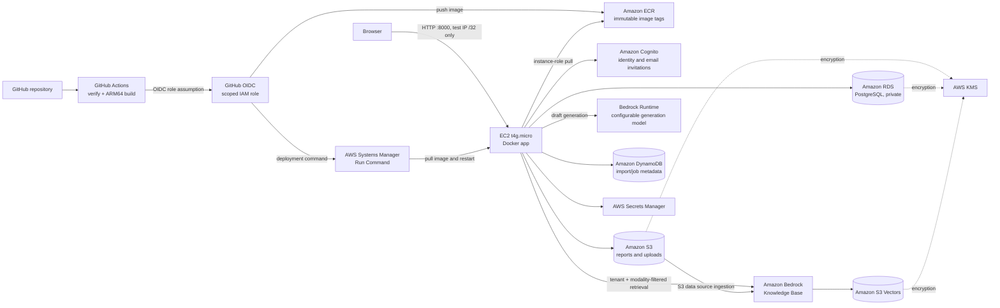
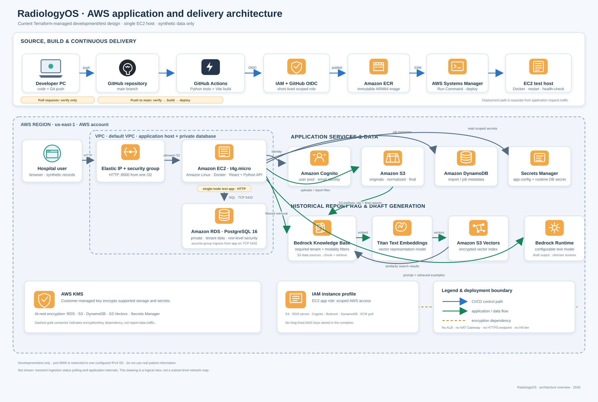

# RadiologyOS

**A multi-tenant radiology reporting workspace with retrieval-assisted drafting and an AWS deployment pipeline.**

RadiologyOS combines a structured report editor, historical-report retrieval, role-based clinical workflows and a platform-administration console. Historical reports are stored in Amazon S3, indexed by Amazon Bedrock Knowledge Bases with Amazon S3 Vectors, then retrieved with tenant and modality filters to provide reference context for a draft. A clinician must review and finalize all generated content.

> **Deployment scope:** The current AWS environment is a low-cost, single-instance development/test deployment. It uses an EC2 public IP with HTTP restricted to a configured `/32` address. Do not enter real patient information or use it for clinical care. Production use would require HTTPS, a domain, security and privacy review, operational monitoring, backup/restore procedures, and high-availability planning.

## Product capabilities

- Structured radiology report editing with save/finalize workflows.
- Retrieval of historical reports by authenticated tenant and modality; study and body-region filters can further narrow retrieval.
- Report assistant that uses retrieved examples for terminology and formatting context. Generated reports are drafts for radiologist review.
- Historical document library with modality selection, upload tracking and ingestion status.
- Tenant-aware account and workspace model with separate platform, hospital and individual account flows.
- Explicit role and capability grants for hospital administrators, radiologists and transcriptionists; signing and AI access are separate permissions.
- Patient/report conversations, report assignments, editing locks, review handoff and saved-report workflows.
- Platform dashboard for account operations, audited access changes, model-token usage visibility and manual-payment records. Subscription billing is not enabled.

## Architecture

See [the AWS architecture diagram and component guide](docs/ARCHITECTURE.md).



## Technology stack

| Area | Technologies |
|---|---|
| Frontend | React, TypeScript, Vite, CSS |
| API/application | Python 3.12, Python standard-library HTTP server, Boto3, Psycopg connection pooling |
| Database and tenant controls | Amazon RDS for PostgreSQL, SQL migrations, PostgreSQL row-level security |
| Identity | Amazon Cognito User Pools, server-side identity verification and session handling |
| Retrieval and generation | Amazon Bedrock Knowledge Bases, Amazon Titan Text Embeddings, Amazon S3 Vectors, Bedrock Runtime Converse API |
| Object and job storage | Amazon S3, Amazon DynamoDB |
| Encryption and secrets | AWS KMS, AWS Secrets Manager, IAM roles and scoped policies |
| Infrastructure | Terraform, Amazon EC2, Amazon ECR, AWS Systems Manager |
| CI/CD | GitHub Actions, GitHub OIDC federation to AWS, Docker Buildx, ARM64 image deployment |

## Repository map

```text
frontend/       React application
server.py       HTTP API and application entry point
saas/           SaaS identity, tenant, permission, workflow and administration services
ingestion/      Historical report processing, S3 library and filtered retrieval
migrations/     Versioned PostgreSQL schema migrations
terraform/      AWS infrastructure and IAM configuration
deployment/     EC2 startup and Docker service configuration
scripts/        Explicit bootstrap, deployment and schema utilities
tests/          Unit and integration tests
docs/           Architecture, operations and deployment guides
.github/        GitHub Actions CI/CD workflow
```

## Implementation and deployment walkthrough

The detailed, repeatable walkthrough is in [Implementation and portfolio guide](docs/IMPLEMENTATION_AND_PORTFOLIO.md). In brief:

1. Develop the React/Python application and maintain schema changes as numbered SQL migrations.
2. Prepare historical reports as individual files with tenant, modality and study metadata; upload them to the correct S3 prefixes and ingest them into the Bedrock Knowledge Base.
3. Use Terraform to provision or update Cognito, private PostgreSQL, encrypted S3/S3 Vectors, DynamoDB, ECR, the testing EC2 host and scoped IAM roles.
4. Run the explicit bootstrap/deploy utility once to apply reviewed schema changes, establish the non-owner runtime database login, populate application configuration and start the initial ECR image.
5. Configure GitHub Actions repository variables for AWS OIDC, ECR and the EC2 instance.
6. Push to `main`. GitHub Actions runs backend tests and a frontend build, creates an ARM64 Docker image, pushes it to ECR and asks EC2 through Systems Manager to deploy and health-check it.

For the exact commands and required GitHub variables, see [GitHub Actions deployment](docs/GITHUB_ACTIONS_DEPLOYMENT.md). For infrastructure recreation and teardown cautions, see [EC2 testing deployment](docs/EC2_TESTING.md).

## Local development

Use synthetic accounts and reports only. The local Compose file expects optional local environment configuration and AWS CLI credentials for AWS-backed features. Keep `.env`, AWS credentials, database credentials and all real reports out of Git.

```powershell
Set-Location "C:\path\to\radiology-reporting"
docker compose up --build
```

Open `http://localhost:8000/`. For the isolated SaaS/PostgreSQL demo and test procedures, use the current instructions in `docs/SAAS_OPERATIONS.md` and `docs/SHARED_DEMO.md`; do not point local tests at the live RDS instance.

## Security and scope notes

- Tenant identity is resolved from the authenticated server-side identity and membership. Tenant and modality filters are mandatory in the historical retrieval path.
- PostgreSQL row-level policies and tenant-scoped operations protect SaaS records; platform administration does not automatically grant patient access.
- Application and deployment AWS permissions use roles. GitHub Actions uses OIDC rather than stored AWS access keys.
- S3, RDS, S3 Vectors and DynamoDB are configured for encryption at rest with KMS; Secrets Manager stores application and runtime database settings.
- Reports generated by AI are drafts. A qualified clinician must verify findings, measurements, laterality, terminology and impression before signing.
- The test deployment is single-node and currently uses HTTP. It is not a production security posture and must not receive PHI.
- Token-usage reporting reflects the model-call paths instrumented by the application; it is not a complete AWS billing ledger.

## Portfolio summary

RadiologyOS demonstrates full-stack development, tenant-aware authorization, retrieval-assisted generation, document ingestion, infrastructure as code, containerized deployment and OIDC-based CI/CD. Use [the portfolio guide](docs/IMPLEMENTATION_AND_PORTFOLIO.md) for suggested screenshots, resume bullets and a LinkedIn project summary. Before making the repository public, review all tracked files and Git history for credentials, account-specific infrastructure values, private data and clinical documents.

## AWS architecture diagram



Open the editable [draw.io architecture file](docs/radiologyos-aws.drawio) in diagrams.net to move icons or reroute arrows. The AWS icons use draw.io's built-in AWS4 library. For the text walkthrough, boundaries and service purposes, see [the detailed architecture guide](docs/ARCHITECTURE.md).
