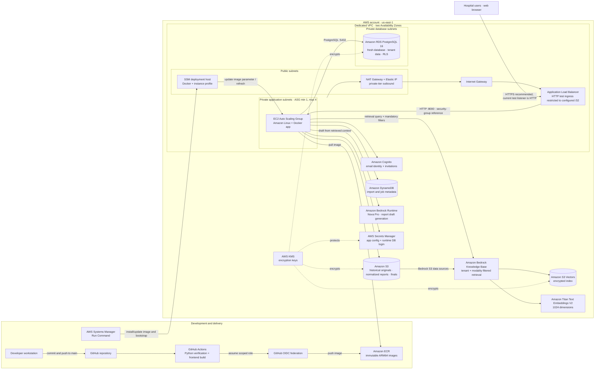

# RadiologyOS architecture

RadiologyOS is a multi-tenant radiology reporting application with retrieval-augmented drafting. The AWS stack separates the public entry point, private application/database tiers, managed identity, clinical data, retrieval, and CI/CD. The diagram documents the current target configuration in Terraform; use the latest deployment outputs to confirm live resource status before publishing screenshots.

## AWS architecture

## Request and data flows

For the detailed browser/API sequence, ingestion and retrieval-generation diagrams, and the implemented RBAC matrix, see [How the web app and RAG work](WEB_APP_AND_RAG.md).

### Sign-in and tenant-scoped application access

1. The browser sends requests to the ALB. The development listener is HTTP and restricted to a configured IPv4 `/32`; it is not a production TLS configuration.
2. Amazon Cognito authenticates users. The backend verifies Cognito tokens and resolves workspace membership and roles server-side.
3. The Python API uses a non-owner PostgreSQL runtime login. PostgreSQL row-level security and tenant-aware application checks protect tenant data.
4. Report editing, assignment, review, finalization, locks, chat history and audit events use the authenticated tenant context. AI access and signing permission are separately granted capabilities.
5. Bedrock Converse input/output/total token counters are recorded per workspace user and model. Platform administrators can view aggregate and per-user usage, including unresolved calls; prompts and report text are not part of these usage records, and this dashboard does not charge customers.
6. Secrets Manager supplies runtime DB credentials and application settings to EC2 through instance roles. AWS credentials are not embedded in the image.

### Historical report RAG

1. Users upload their historical reports through the tenant-scoped library. Each uploaded source is stored in S3 and associated with tenant, modality and study metadata.
2. Bedrock Knowledge Base S3 data sources ingest supported prefixes. Bedrock chunks documents and invokes Titan Text Embeddings V2; the encrypted S3 Vectors index stores embeddings and filterable metadata.
3. For a new draft, the backend searches those previously uploaded historical reports for matching examples. It requires a modality, resolves prompt/dropdown conflicts, applies tenant and modality filters, and checks returned metadata before using source text.
4. Bedrock Runtime (currently configured for Nova Pro) receives the current user instruction and permitted retrieved examples from the uploaded historical library. The assistant returns a draft; a qualified clinician reviews and finalizes it.

Retrieval examples provide style and terminology context; they do not establish clinical truth. Measurements, laterality, findings and impressions must be verified by a clinician.

### CI/CD and autoscaling rollout

1. A push to `main` runs backend verification and a production frontend build in GitHub Actions. Pull requests run verification without deployment.
2. GitHub Actions obtains short-lived AWS credentials through OIDC and a repository/branch-scoped IAM role.
3. Docker Buildx builds an ARM64 image with a unique immutable tag (commit SHA, workflow run ID and attempt), then pushes it to ECR.
4. The workflow updates the SSM image parameter and starts a rolling EC2 Auto Scaling instance refresh. EC2 instance profiles authorize image pulls and secret access.
5. The workflow waits for refresh completion and checks ALB target health. The ASG uses CPU target tracking and has a configured maximum of four instances.

## AWS service responsibilities

| Service | Responsibility | Trust boundary |
|---|---|---|
| VPC, subnets, route tables, security groups | Isolate public ALB, app tier and private RDS tier | App ingress only from ALB; DB ingress only from app security group |
| Application Load Balancer | Browser entry and health-checked traffic distribution | Development HTTP listener is restricted to one configured `/32` |
| EC2 Auto Scaling Group | Run Dockerized app instances and replace unhealthy hosts | Private subnets, instance profile, max size 4 |
| EC2 deployment host + Systems Manager | Explicit bootstrap and controlled deployment operations | No inbound SSH; commands use scoped IAM |
| Amazon ECR | Private ARM64 application image registry | Immutable per-run tags and lifecycle retention |
| Amazon RDS for PostgreSQL | SaaS identity, tenant, workflow, audit, chat and report state | Private subnets, non-owner runtime role, row-level policies |
| Amazon Cognito | Sign-in, token issuance and user invitations | Backend validates tokens and memberships |
| Amazon S3 | Historical originals, normalized references, final reports and deployment bundles | Block public access, TLS-only policy, KMS encryption |
| Bedrock Knowledge Bases + S3 Vectors | Ingest, chunk, embed and retrieve historical report context | Tenant/modality metadata filters enforced by backend |
| Amazon Bedrock Runtime | Generate report drafts using retrieved references | Model access through EC2 role; clinician review required |
| PostgreSQL model-token events + platform dashboard | Monitor actual Bedrock input/output/total tokens per workspace user and unresolved calls | Platform-admin-only usage view; no prompt/report text or customer charging |
| Amazon DynamoDB | Import/job state and related metadata | Application role with scoped table/index permissions |
| AWS KMS + Secrets Manager | At-rest encryption and runtime configuration/credentials | Scoped role access; secrets are never baked into images |
| GitHub Actions + OIDC IAM | Verify, build, publish and roll out application image | Short-lived identity restricted to the configured repository/ref |

## Security and scaling decisions

- **Tenant context is server-owned:** browser-supplied tenant IDs are not authoritative. Membership and capability checks run on the backend.
- **Defense in depth:** application authorization, database row-level security, private networking and security-group references protect separate layers.
- **Least privilege:** EC2 and GitHub deployment roles are separate; GitHub uses OIDC; database master credentials are reserved for bootstrap operations.
- **No static cloud keys in the image:** runtime access uses instance profiles and Secrets Manager.
- **Scale-out:** ALB health checks and CPU target tracking support an ASG up to four instances. The current cost-conscious network uses one NAT Gateway, which is a single egress availability point.
- **Stateful storage is managed separately:** RDS, S3 and DynamoDB are not stored on EC2 instance disks. A full Terraform teardown can still delete them depending on configured safeguards.

## Current limitations to describe honestly

- This is a development/test deployment, not a clinically validated production service. Use synthetic data in portfolio screenshots.
- The configured ALB listener is HTTP and does not provide domain-based HTTPS. Production requires a domain, TLS certificate, HTTPS listener and appropriate network/security review.
- A single NAT Gateway reduces cost but is not highly available. The ASG ceiling is four; this is not a high-scale capacity guarantee.
- Do not claim formal regulatory compliance, clinical accuracy, disaster recovery or high availability without separate evidence and operational validation.
- Token usage is application-level model usage telemetry, not a complete AWS billing ledger.

## Diagram files

- [SVG architecture image](aws-architecture.svg) is the portfolio-ready system diagram.
- The Mermaid diagram above is the maintained editable source in GitHub Markdown.
