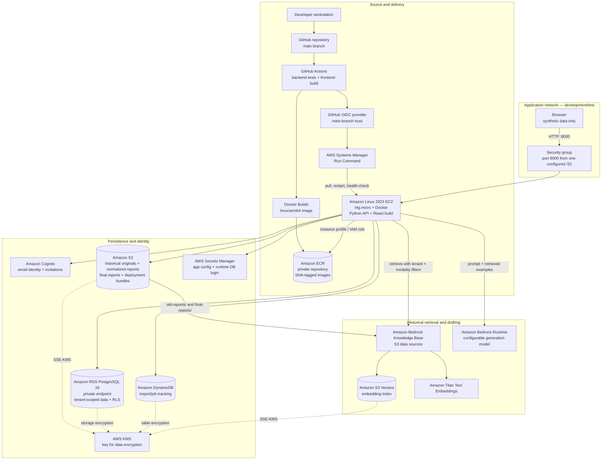
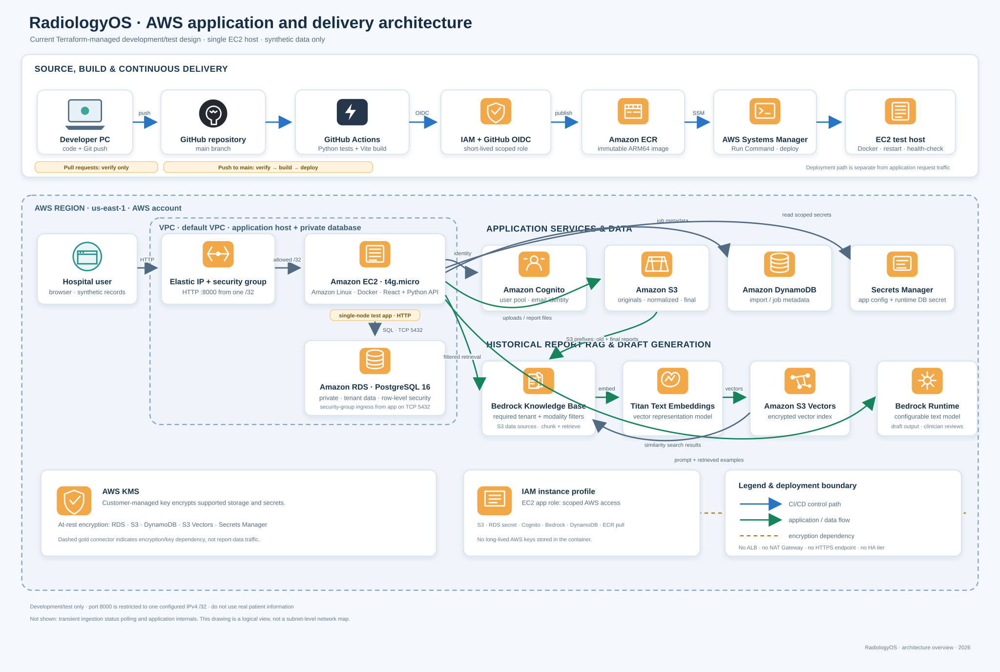

# RadiologyOS AWS architecture

This diagram reflects the current Terraform-managed development/testing design. It is a single EC2 application host, not a high-availability production topology.

## Diagram

## Request paths

### User sign-in and application data

1. A browser opens the test EC2 endpoint. The security group permits port 8000 only from the configured client IPv4 `/32`.
2. Cognito authenticates the user. The backend validates the resulting identity and resolves workspace membership and permissions server-side.
3. The application reads and writes tenant-controlled records in PostgreSQL using the dedicated runtime login. PostgreSQL row-level security and application authorization provide additional tenant boundaries.
4. Application files and report objects use S3. DynamoDB stores historical-import/job tracking. Configuration and the runtime database password come from scoped Secrets Manager secrets.

### Historical report retrieval and draft generation

1. A historical report is uploaded to S3 and normalized/classified with metadata such as tenant, modality, study and body region.
2. Bedrock Knowledge Base data sources ingest supported S3 prefixes. The Knowledge Base chunks and embeds text, using Amazon Titan Text Embeddings, then stores vectors in S3 Vectors.
3. A draft request is authenticated; the backend resolves tenant and modality, applies them as required retrieval filters, and rechecks returned metadata before loading source text.
4. The Bedrock Runtime generation model receives the current instruction and retrieved reference examples. The result is returned as a draft for clinician review.

### Continuous delivery

1. A push to `main` starts GitHub Actions. Pull requests run verification only.
2. The workflow runs Python tests and builds the frontend. The deployment job assumes a narrowly scoped AWS role through GitHub OIDC.
3. Docker Buildx builds a SHA-tagged ARM64 image and pushes it to ECR.
4. The workflow sends an SSM Run Command to the EC2 host. The instance profile authorizes ECR pull; the host downloads the new image, restarts the service and checks `/api/health`.
5. If health checking fails, the deployment script attempts to restore the previous image.

## AWS components

| Component | Purpose |
|---|---|
| EC2, Amazon Linux 2023, Docker | Runs the single-node web/API application |
| Security group and Elastic IP | Test access on port 8000 from one configured client IP |
| RDS for PostgreSQL | Tenant, membership, patient/report workflow and application data; private endpoint |
| Cognito User Pool | User identity, email-based sign-in and invitation lifecycle |
| S3 | Historical source documents, normalized/indexed reports, final reports and temporary deployment bundles |
| Bedrock Knowledge Base | S3-backed ingestion and filtered retrieval |
| S3 Vectors | Vector index used by the Bedrock Knowledge Base |
| Bedrock Runtime | Text generation using the configured foundation model |
| DynamoDB | Historical import/job state and related metadata |
| KMS and Secrets Manager | Encryption key and runtime/application secrets |
| ECR | Private container registry with immutable SHA image tags and lifecycle retention |
| Systems Manager | Remote deploy command channel; no inbound SSH is needed |
| GitHub OIDC IAM role | Lets only the configured GitHub repository/branch publish to ECR and invoke SSM |

## Boundaries and non-goals

- This deployment has one EC2 instance and no load balancer, autoscaling group or multi-AZ application tier.
- The public-IP test path uses HTTP and must be limited to synthetic data. HTTPS/domain termination is not included.
- This topology does not by itself constitute a clinical security, privacy, regulatory or production-readiness review.
- Terraform, migrations, GitHub Actions and AWS data resources must be reviewed as separate change surfaces. Do not apply a plan that unexpectedly replaces or destroys stateful resources.

## Full AWS service-icon diagram

The following SVG is the portfolio-sized diagram with service symbols, labeled arrows and deployment/security boundaries. It is a logical architecture view, not a literal subnet map.

The vector file can be opened directly, embedded in a portfolio page, or exported to PNG/PDF for presentation use.

### Editable draw.io source

Open [radiologyos-aws.drawio](radiologyos-aws.drawio) in [diagrams.net](https://app.diagrams.net/) or the draw.io desktop app. The AWS service marks use draw.io's built-in AWS4 Architecture Icons library; they remain editable as draw.io shapes. Use **File → Open From → Device** to load the file, then **File → Export as** to save a PNG, SVG or PDF for a portfolio. The S3 Vectors and Bedrock Knowledge Base labels use the closest AWS4 S3 and Bedrock service icons, respectively, with the exact managed service named in the label.
