# RadiologyOS portfolio screenshots

These selected images show the deployed application, historical-report ingestion, usage monitoring, and delivery workflow. Screenshots were cropped or redacted to omit report text and direct user/workspace identifiers. Keep future captures limited to synthetic data; do not publish real patient records, credentials, account identifiers, or secret values.

## Cloud architecture

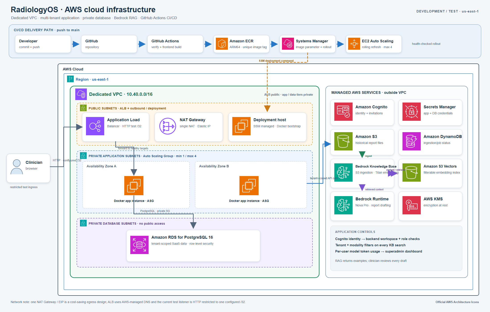

**AWS cloud infrastructure.** Dedicated VPC, public ALB, private EC2 Auto Scaling Group, private PostgreSQL, and connected managed AWS services. This depicts the development deployment; the HTTP listener and single NAT Gateway are documented limitations.

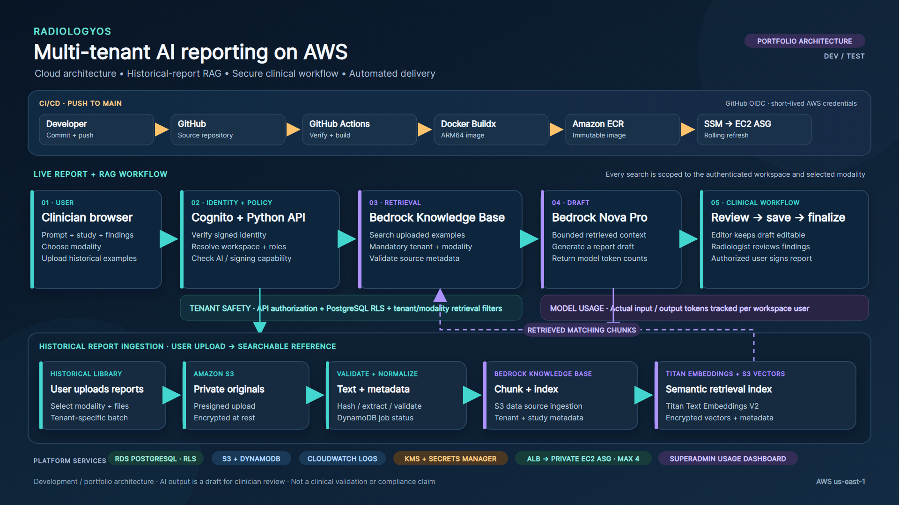

**Report-generation workflow.** Shows the request path, tenant and modality filtered retrieval from uploaded historical reports, AI drafting, and clinician review before finalization.

## Application and operations

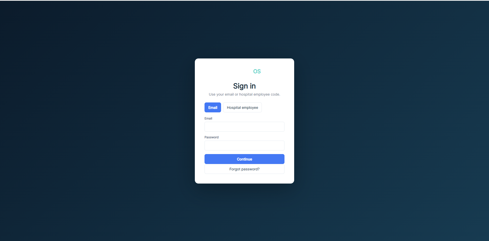

**Sign-in page.** Shows the authentication entry point for email and hospital employee credentials. The capture contains no entered credentials.

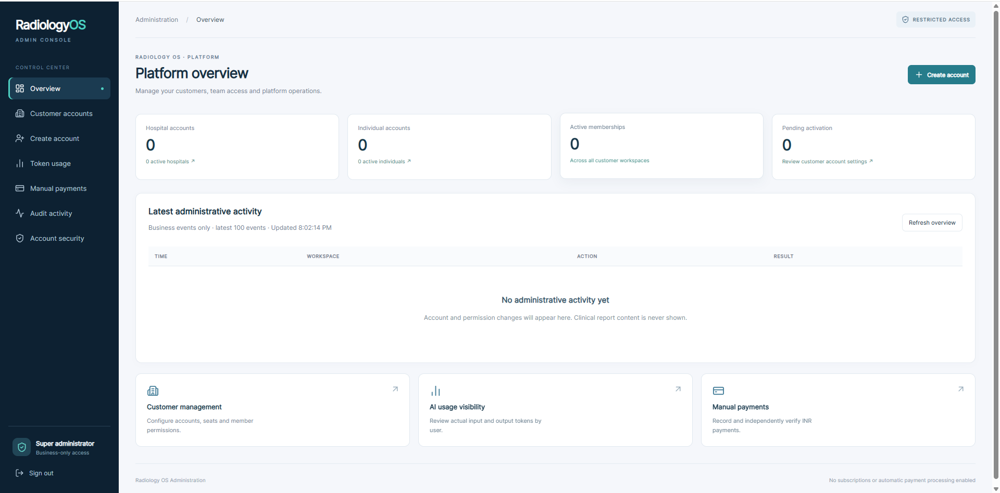

**Platform admin panel.** Shows the administrative overview and links into customer management, AI usage visibility, and manual payments.

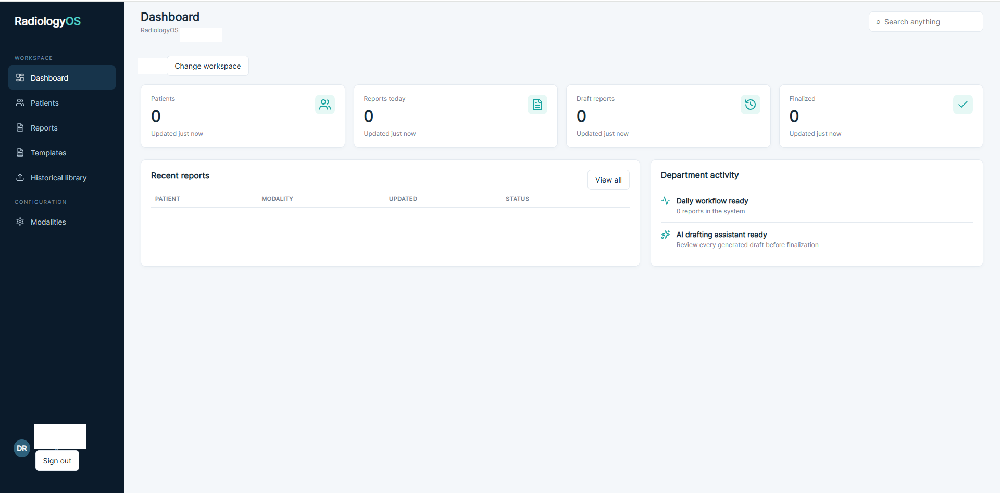

**Radiologist workspace.** Shows the clinical workspace dashboard and report activity panels. User/workspace labels were removed from the screenshot.

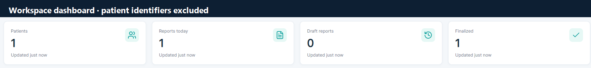

**Workspace dashboard.** Application overview metrics; patient-level rows and identifying details are excluded.

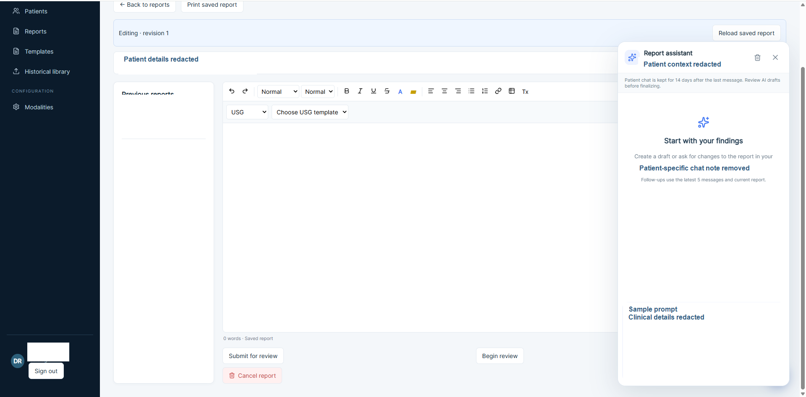

**AI chat input.** Shows the report editor beside the prompt composer. Patient details and the actual clinical prompt are redacted.

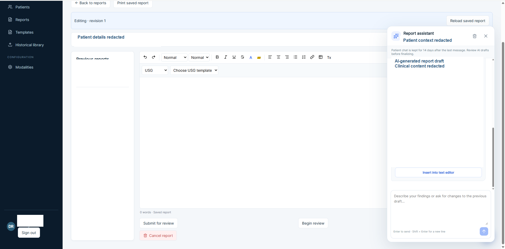

**AI chat output.** Shows the generated draft preview and the option to insert it into the report editor. Patient and report text are redacted; generated content remains a clinician-reviewed draft.

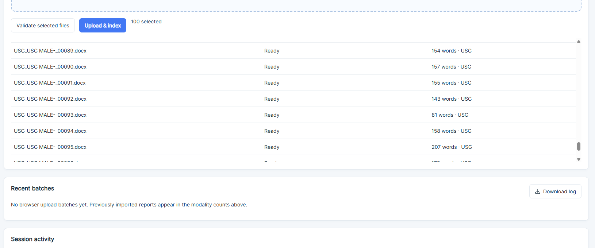

**Historical-library validation.** Shows a batch of 100 reference reports validated and ready for upload.

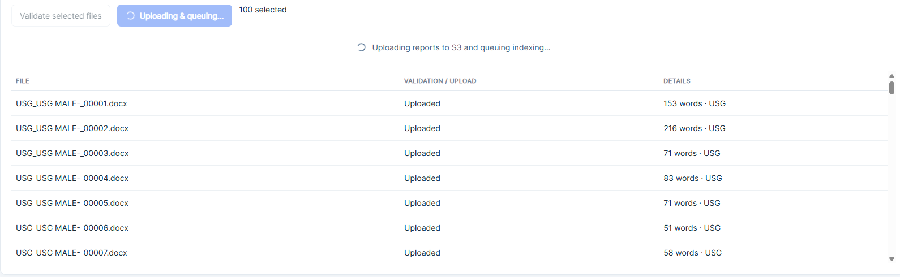

**Upload and indexing queue.** Shows the browser upload state and indexing handoff for selected historical reports.

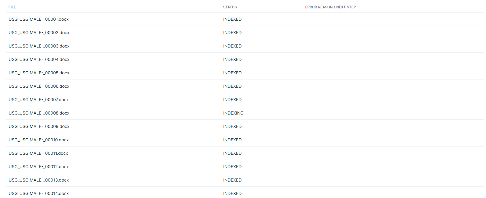

**Per-document indexing status.** Illustrates that indexing progress is tracked for individual uploaded files.

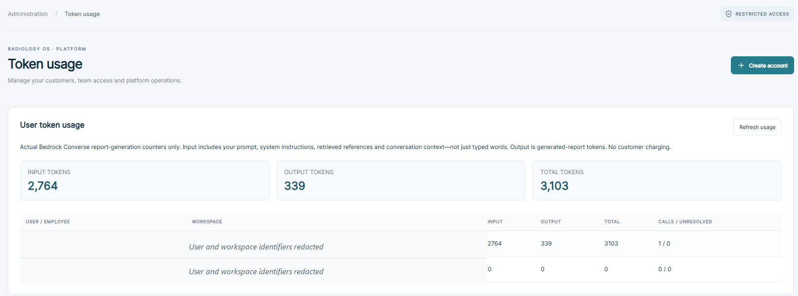

**Token usage monitoring.** Displays aggregate input, output, and total model token counters with user and workspace identifiers redacted. These are usage counters, not a billing ledger.

## CI/CD

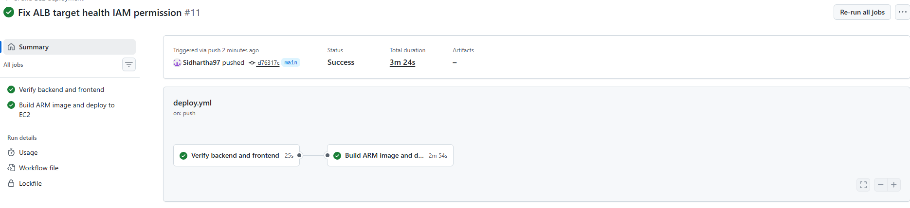

**GitHub Actions deployment.** Shows successful verification and image-build/deployment jobs for a workflow run.
