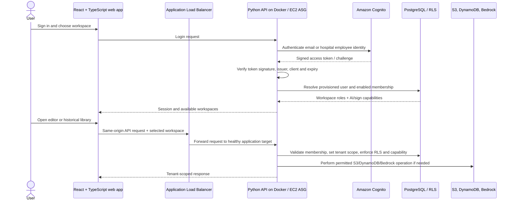
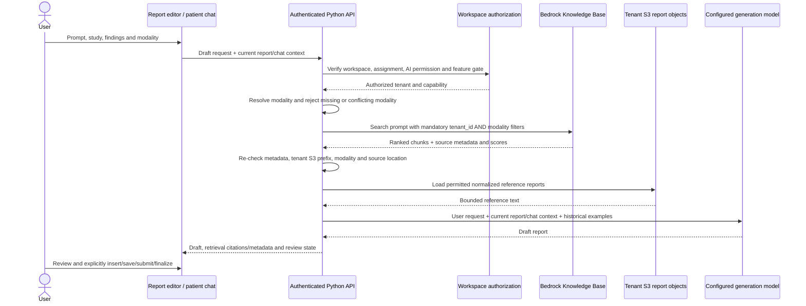

# How the RadiologyOS web app works

This guide follows a request from browser to database or RAG service, explains how historical reports become searchable, and documents the implemented workspace roles. It describes the current code and configuration gates; it is not a claim of clinical validation or regulatory compliance.

## 1. Web application request flow

### Sign-in and workspace resolution

1. The browser signs in through the API. Users can use email; hospital staff can use hospital ID plus employee code, with email retained for verification and account recovery.
2. Cognito authenticates the identity. The backend verifies the token and maps its trusted issuer and subject to a provisioned application user. Browser-supplied role names are not trusted.
3. The user selects one of their enabled workspaces. The API loads that workspace's membership from PostgreSQL and carries the resolved tenant in server-side request scope.
4. Workspace database transactions set transaction-local tenant/user identity values. A non-owner runtime database role, explicit tenant predicates and PostgreSQL row-level security provide layered data isolation.
5. The API checks the required capability for every protected operation. A hidden/disabled UI control is only a usability measure; the backend is authoritative.

### Report editing and workflow

- The React editor reads the authenticated user's permitted patients/reports and submits changes through the API.
- Hospital report edits use a time-limited editing lease, report version checks and fencing values. Another editor cannot silently overwrite an active edit. Individual workspaces use version checks without hospital shared-edit leases.
- Reports can be saved as drafts, submitted for review, returned for correction, reviewed, finalized by an explicitly authorized radiologist, or amended through a linked new version. A signed revision is preserved as a snapshot; editing it in place is blocked.
- Assignment and handoff are workspace-scoped. A transcriptionist can submit a report for radiologist review; handoff does not sign it.
- Audit events record important access/workflow changes without placing report text in platform administration views.

## 2. Historical report ingestion: from file to searchable reference

```mermaid
flowchart LR
  A[User chooses modality and files] --> B[Browser validates file selection]
  B --> C[API checks file format, size, text and modality]
  C --> D[API creates tenant-scoped batch and signed S3 POST]
  D --> E[Browser uploads directly to private S3]
  E --> F[Worker verifies size and SHA-256]
  F --> G[Extract text, classify and normalize report]
  G --> H[Write normalized TXT + metadata sidecar to tenant prefix]
  H --> I[Start / reuse Bedrock KB data-source ingestion]
  I --> J[Bedrock chunks text and calls Titan Embeddings V2]
  J --> K[(S3 Vectors stores embeddings and metadata)]
  H --> L[(DynamoDB stores batch, manifest and per-file status)]
  I --> L
  K --> M[Document status synchronized to Indexed / Failed]
```

### Ingestion sequence

1. A user with the required workspace access selects a modality and uploads historical reports to that workspace's library as separate DOCX, text-based PDF or TXT files. The library accepts up to 100 files per batch and 10 MB per file. It validates format, extracts text, checks report suitability and computes a content hash before upload.
2. The backend creates a tenant-specific batch and one-hour presigned S3 POST forms. Each form is restricted to a server-generated key and the validated file size. The browser sends the file directly to S3; AWS credentials do not enter the browser.
3. The background worker reads each historical report the user uploaded, verifies exact size and SHA-256, then re-validates and normalizes its text. It writes normalized text and a Bedrock metadata sidecar under the tenant's normalized-report prefix. Original files remain separately stored.
4. The worker records per-document processing state in DynamoDB and starts or reuses the Bedrock Knowledge Base ingestion job for the data source. A shared ingestion job can contain documents from more than one tenant; the UI reports only the current tenant's document states.
5. Bedrock reads the S3 data-source prefix, divides normalized text into configured chunks, invokes Titan Text Embeddings V2 and stores vectors plus filterable metadata in S3 Vectors. The Terraform defaults are 400 tokens per chunk and 15% overlap, with a 1024-dimensional embedding index.
6. The worker reconciles Bedrock's document-level status into `INDEXED` or `FAILED`. A job marked `COMPLETE` is not by itself proof every document indexed; inspect each file's status and error details in Recent batches.

Metadata such as `tenant_id`, `modality`, `study_key`, `body_region`, `report_type` and `report_id` enables scoped retrieval and traceability. Accurate source folder, study and modality classification is important: retrieval filters cannot repair incorrect source metadata.

## 3. Report generation: how RAG is used

### Retrieval safeguards and ranking

When a user asks for a draft, RadiologyOS searches the historical reports already uploaded and indexed for that workspace. It does not fetch examples from a public report corpus. The uploaded reports provide reference examples for the current request, subject to the filters and checks below.

- The backend resolves tenant identity from the authenticated workspace scope, never from a prompt or request-body tenant field.
- A modality must be selected or identified in the request. A prompt/dropdown conflict is rejected for confirmation. The API does not search across modalities as a fallback.
- Every Knowledge Base search includes both `tenant_id` and `modality`. The search may first narrow by `study_key` or `body_region`; if that narrower search has no matches, it can relax those optional restrictions while retaining tenant and modality.
- Results are sorted by relevance score and limited by configured top-K/context bounds. Before loading report text, the backend checks returned metadata and confirms the S3 object belongs to the configured bucket and allowed tenant prefixes.
- The response includes source citations/identifiers and retrieval scores where available. A missing suitable reference produces a no-match response rather than silently substituting a different tenant or modality.

### Generation behavior and clinical boundary

- Matching reports retrieved from the user's uploaded historical library are examples for report structure, wording, section order and terminology. They are not evidence about the current patient.
- The current prompt is authoritative. The generation instructions prohibit transferring old patient identifiers, measurements, abnormalities, histories or recommendations into a new report. Retrieved documents are treated as untrusted content, not as instructions.
- Edit requests use the current editor report as the baseline and apply changes while preserving unrelated content. The patient/report chat is scoped to that report and retains bounded recent conversation context according to the configured retention policy.
- The configured Bedrock model (currently Nova Pro in the documented AWS setup) or explicitly configured supported provider generates a draft from the prompt and retrieved context. The AI feature flag must also be enabled.
- The generated response is a draft. A qualified radiologist must review clinical facts, measurements, laterality, internal consistency and impression before signing/finalizing. Retrieval relevance is not diagnostic validation.

### AI token usage monitoring

- For Bedrock Converse model calls, the application records provider-reported input, output and total token counts against the authenticated workspace user, workspace and model. Input usage can include system instructions, the current prompt, retrieved report context and conversation history; it is not just the user's typed words.
- The platform superadmin dashboard displays totals and per-user usage, call counts and unresolved calls. Calls with missing or uncertain provider counters are reported as unresolved and excluded from known token totals rather than treated as zero.
- Usage events store counters and limited request/model metadata, not the prompt, generated report or retrieved report text. This is an operational usage view, not a complete AWS billing ledger or customer charge system.
- The current tracker wraps Bedrock Converse calls. Do not claim it tracks every provider path unless the relevant provider has its own verified usage integration.

## 4. Role-based access control (RBAC)

Authorization is deny-by-default and is enforced in backend services, not only in the interface. Roles are workspace memberships; a person may belong to more than one workspace. AI use and clinical signing are separate boolean capabilities on the membership.

| Account / workspace role | Data and workflow access | AI access | Signing / administration |
|---|---|---|---|
| Platform super administrator | Platform account, invitations, tenant configuration, access settings, usage and audit administration; platform queries do not return patient/report bodies | No clinical AI access from platform role alone | Can manage business/customer access. Must also have an explicit clinical workspace membership for clinical access. Sensitive administrative changes require recent re-authentication and are audited. |
| Hospital administrator | Hospital business settings, membership and user invitation controls when tenant settings permit | Not granted by this role alone | Does not automatically gain clinical report access or signing. A separately granted clinical role/capability is needed. |
| Radiologist | All reports within the member's tenant; review, assignment, amendment and clinical workflow actions | Only if `can_use_ai` is granted and the global AI feature gate is enabled | Finalize/sign only if `can_sign` is explicitly granted. |
| Transcriptionist | Assigned reports and related permitted patient records; create/edit assigned work and submit/handoff for radiologist review | Assigned-report chat only, when `can_use_ai` is granted and the global AI gate is enabled | Cannot review or sign. Handoff sends work to a radiologist; it does not finalize the report. |
| Individual owner | Workspace administration; clinical report permissions are supplied by the individual workspace's radiologist membership | Only if `can_use_ai` is granted and AI is enabled | Individual workspace setup pairs owner and radiologist roles; signing still requires `can_sign`. |

### Capability checks in practice

| Capability | Backend rule (summary) |
|---|---|
| Read/create/edit reports | Radiologist or transcriptionist; report visibility remains tenant-scoped, and non-radiologists are limited to assigned work. |
| Read all reports / historical library | Radiologist capability within that tenant. Hospital administrator role alone is not a clinical role. |
| Submit work | Radiologist or transcriptionist. |
| Review / amend | Radiologist. |
| Sign / finalize | Radiologist **and** explicit `can_sign=true`. |
| Generate AI | Explicit `can_use_ai=true`, an eligible clinical role, route-specific scope/assignment checks, and `SAAS_AI_ENABLED=true`. Transcriptionists use the assigned-report chat path. |
| Invite / deactivate hospital users | Hospital administrator in a hospital workspace, subject to `allow_hospital_admin_create_users` and available seats. |
| Platform administration | Explicit `platform_admin` database role. It grants business administration, not patient-data permissions. |

Access updates validate role combinations (for example, signing requires a radiologist role and AI requires a radiologist or transcriptionist role), use optimistic membership versions, require an administrative reason, revoke active report locks after changes and write audit events. Hospital staff can be deactivated without deleting report history. Account deletion follows a separate explicitly confirmed customer-workspace deletion workflow when enabled.

### Tenant isolation layers

1. **Identity:** verified Cognito issuer/subject is mapped to an enabled application user.
2. **Membership:** the selected workspace must have an enabled membership for that user; request parameters cannot create membership.
3. **API authorization:** every route checks a specific capability and, for reports/chat, assignment or tenant ownership.
4. **Database:** transaction-local tenant context, tenant-keyed rows, a non-owner runtime database role and PostgreSQL RLS constrain reads/writes.
5. **Object/vector retrieval:** S3 keys are tenant-prefixed; retrieval requires tenant and modality metadata filters and validates returned metadata before reference text is loaded.
6. **Administration:** platform screens expose business metadata and usage aggregates rather than clinical report bodies; sensitive changes are audited and require recent authentication.

## Configuration and verification notes

- `SAAS_ENABLED` selects the SaaS authentication/workspace API path.
- `SAAS_AI_ENABLED` is an additional global generation gate; individual membership AI permission does not override it.
- `can_use_ai` and `can_sign` are workspace membership capabilities, not implied by account creation or role labels.
- `SAAS_USER_PROVISIONING_ENABLED` controls live invitation delivery; tenant settings also control whether hospital administrators may invite staff.
- Verify RBAC using synthetic identities: test platform-only access to the admin dashboard, hospital-admin business controls, radiologist access to tenant reports, transcriptionist access to assigned reports/chat, and denied cross-tenant/report access. Also test AI and signing independently with each capability enabled and disabled.
